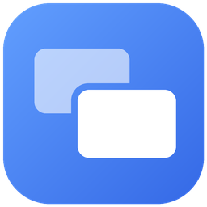
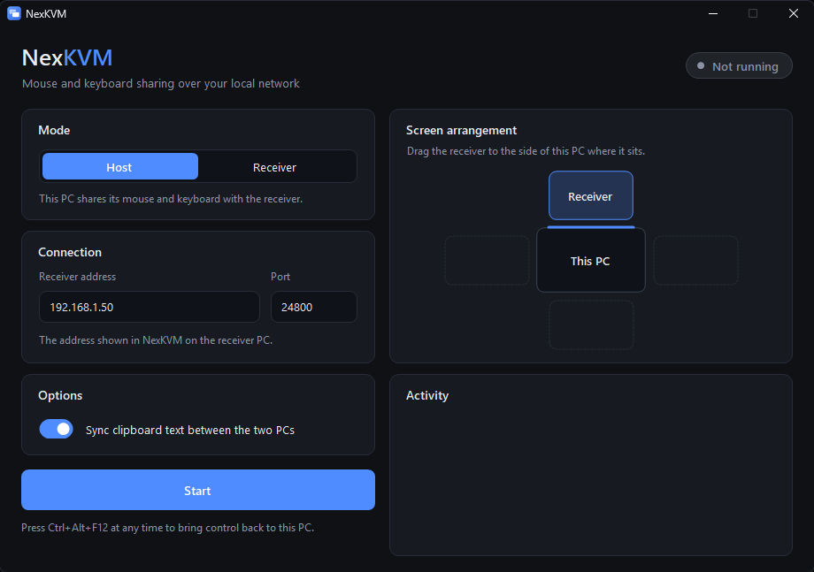

<p align="center">
  
</p>

<h1 align="center">NexKVM</h1>

<p align="center">
  <b>One mouse and keyboard for two Windows PCs, over your local network.</b><br>
  Move the pointer off the edge of one screen and carry on working on the other.
</p>

<p align="center">
  <a href="https://github.com/Ayonto/NexKVM/releases/latest"></a>
  
  
  <a href="LICENSE"></a>
</p>

<p align="center">
  <a href="https://github.com/Ayonto/NexKVM/releases/latest"><b>Download</b></a> ·
  <a href="#quick-start">Quick start</a> ·
  <a href="#how-it-works">How it works</a> ·
  <a href="#troubleshooting">Troubleshooting</a>
</p>

<p align="center">
  
</p>

## Overview

NexKVM is a software KVM switch. It lets the mouse and keyboard attached to one PC control a
second PC on the same network, as if the second machine were an extra monitor. The keyboard
follows the pointer, and copied text is available on both machines.

It is a single executable with nothing to install. The same file runs on both computers.

## Features

| | |
|---|---|
| **Edge crossing** | The pointer leaves one screen and continues on the other from the matching position. |
| **Screen arrangement** | Drag the other PC to the left, right, top or bottom of yours, as in the Windows display settings. |
| **Keyboard follows the pointer** | Keys are forwarded by scan code, so layouts, modifiers and shortcuts behave normally. |
| **Clipboard sync** | Copy text on one PC and paste it on the other. |
| **Low latency** | Native input hooks, direct input injection and an unbuffered connection keep movement natural on a LAN. |
| **Failsafe** | `Ctrl+Alt+F12` returns control to the host at any time. Control also returns by itself if the connection drops. |
| **No install** | One self-contained `.exe`. The .NET runtime is bundled. |

## Requirements

- Two PCs running Windows 10 or Windows 11 (64-bit).
- Both on the same local network, wired or Wi-Fi.

## Quick start

Download `NexKVM.exe` from the [latest release](https://github.com/Ayonto/NexKVM/releases/latest)
and copy it to both computers.

### 1. On the PC you want to control (the receiver)

1. Run `NexKVM.exe` and set **Mode** to **Receiver**.
2. Note the address shown under **This PC's address**, for example `192.168.1.50`.
3. Press **Start**. The status shows *Waiting for host*.
4. If Windows Firewall asks, allow access on **Private** networks.

### 2. On the PC with the mouse and keyboard (the host)

1. Run `NexKVM.exe` and set **Mode** to **Host**.
2. Enter the receiver's address.
3. Under **Screen arrangement**, drag the receiver to the side of your PC where it physically sits.
4. Press **Start**. The status shows *Connected*.

### 3. Use it

Move the pointer off the chosen edge of the host's screen. It appears on the receiver, and the
keyboard goes with it. Move back across the same edge to return.

> **Stuck on the other PC?** Press `Ctrl+Alt+F12` on the host's keyboard.

## Settings

| Setting | Where | Notes |
|---|---|---|
| Mode | Both | **Host** shares its mouse and keyboard. **Receiver** is controlled. Any PC can take either role. |
| Receiver address | Host | The IPv4 address shown in NexKVM on the receiver. |
| Port | Both | Default `24800`. Must match on both PCs. |
| Screen arrangement | Host | The side the receiver sits on. This is the edge the pointer crosses. |
| Sync clipboard text | Both | Turn off on either PC to stop sharing copied text. |

Settings are remembered between runs.

## Troubleshooting

| Symptom | What to check |
|---|---|
| Host stays on *Connecting* | The receiver is started, the address and port match, and both PCs are on the same network. |
| Receiver never shows *Connected* | Windows Firewall on the receiver. Allow NexKVM on Private networks, or add the rule below. |
| Pointer will not enter some windows on the receiver | Those windows run as Administrator (Task Manager, UAC prompts). Run NexKVM as Administrator on both PCs. |
| Pointer feels slower or faster on the receiver | Movement maps one host pixel to one receiver pixel, so a large difference in resolution changes the feel. |
| Pointer is stuck on the receiver | Press `Ctrl+Alt+F12` on the host. |

To add the firewall rule by hand, run this in an elevated PowerShell on the receiver:

```powershell
New-NetFirewallRule -DisplayName "NexKVM" -Direction Inbound -Protocol TCP -LocalPort 24800 -Action Allow -Profile Private
```

## Security

NexKVM is intended for a trusted home or office network. The connection is not encrypted and
not authenticated, so anyone on the same network who can reach the receiver's port could
control that PC while the receiver is running. Do not forward the port to the internet, and
stop the receiver when you are on a network you do not trust.

## How it works

| Part | Approach |
|---|---|
| Capture (host) | Low-level mouse and keyboard hooks (`WH_MOUSE_LL`, `WH_KEYBOARD_LL`) on a dedicated high-priority thread. |
| Edge crossing | While the pointer is away, the host swallows mouse moves in the hook, so its own cursor stays still, and feeds each movement into a virtual cursor sized to the receiver's screen. Nothing is warped or re-centred. |
| Positioning | The host sends absolute, normalised positions rather than relative moves, so the two sides cannot drift apart. |
| Hidden cursor | The host swaps the system cursors for a blank one while it controls the receiver, and restores them on return. |
| Injection (receiver) | `SendInput` with scan codes and absolute coordinates. |
| Transport | One TCP connection with Nagle's algorithm disabled and small length-prefixed binary frames. |
| Safety | Keys and buttons still held are released on hand-back. `Ctrl+Alt+F12` or a lost connection returns control to the host. |

## Building from source

Requires the [.NET 8 SDK](https://dotnet.microsoft.com/download/dotnet/8.0).

```bash
dotnet run
```

To produce the single-file release executable in `publish/`:

```powershell
powershell -ExecutionPolicy Bypass -File build-release.ps1
```

### Project layout

| File | Purpose |
|---|---|
| `HostEngine.cs` | Input capture, edge detection and the crossing state machine. |
| `TargetEngine.cs` | Receiver: listens for the host and applies its input. |
| `Protocol.cs` | Framed binary protocol over TCP. |
| `Injector.cs`, `CursorHider.cs`, `ClipboardMonitor.cs` | Input injection, cursor hiding and clipboard sync. |
| `MainForm.cs`, `Controls.cs`, `ArrangementView.cs`, `Theme.cs` | The user interface. |
| `Native.cs` | Win32 declarations. |

## Limitations

- Windows to Windows only.
- Clipboard sync covers text, not images or files.
- One receiver per host.
- On a host with several monitors, the crossing edge is the outer edge of the whole desktop on the chosen side.
- The receiver is controlled on its primary monitor.

## License

Released under the [MIT License](LICENSE).
